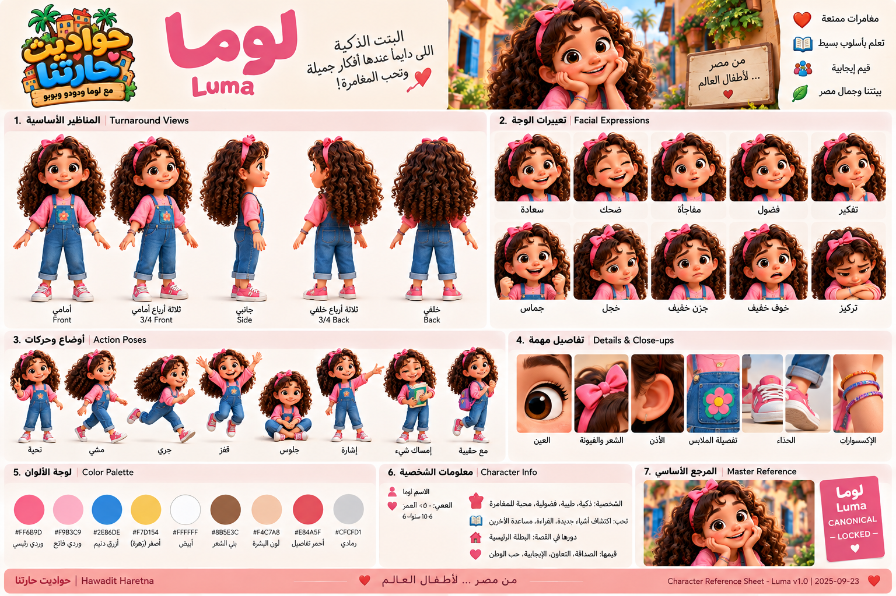
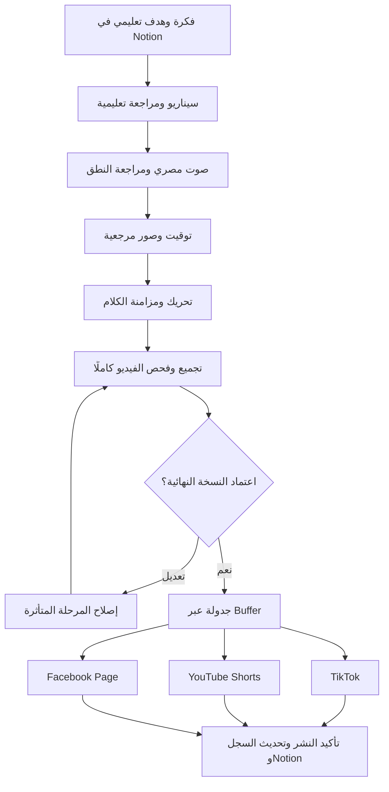

<div align="center">

# مَرَح · Marah Content Studio

**قصص مصرية صغيرة، يتعلّم منها الأطفال كل يوم.**

من الفكرة إلى فيديو متحرك بصوت مصري، ثم مراجعة وجدولة عبر Buffer.

**الفئة العمرية: ٢–٦ سنوات · أول إنتاج مستهدف: ٣٠ ثانية · المرحلة: تأسيس وتنفيذ تدريجي**

[خطة الأتمتة](docs/automation-plan.md) · [مكتبة المحتوى](content/notion/README.md) · [دليل المزامنة](docs/notion-sync.md) · [حالة التسليم](docs/delivery-status.md)

</div>

> [!IMPORTANT]
> هذا المستودع يحتوي التوثيق ونسخة محتوى Notion وأداة مزامنة مُعدة. **إنتاج الفيديو والنشر الآلي لم يُشغّلا بعد**، ومزامنة Notion متوقفة لحين إعداد الوصول وتفعيلها. الجداول التالية تميز الموجود من المستهدف.

## الفكرة

«مَرَح» قناة تعليمية بشخصيات ثابتة: لوما ودودو وبوبو. نستخدم مواقف من الحياة المصرية لتعليم الألوان والأرقام والسلوك والتعاون والاستئذان، بقصة واضحة وحوار بسيط وحركة فعلية.

الهدف بناء نظام إنتاج قابل للتكرار: يحافظ على الشخصية والهدف التعليمي، يسجل التكلفة والنسخ، ويتوقف للمراجعة قبل النشر العام.

## العالم البصري والشخصيات

الصورة التالية **مرجع أرشيفي من Notion** لشكل العالم والشخصيات، وليست لقطة لفيديو منتج. تحمل الاسم السابق «حواديت حارتنا» وبعض تفاصيل قديمة؛ **الاسم الحالي مَرَح**، وقواعد الملابس والعمر والجودة المكتوبة هنا وفي [AGENTS.md](AGENTS.md) هي المرجع عند التعارض.


| الشخصية | الهوية الثابتة | الصوت |
| --- | --- | --- |
| **لوما · Luma** | بلوزة وردية طويلة الأكمام، سالوبيت جينز، فيونكة وردية | صوت مصري ثابت، واضح ومناسب للأطفال |
| **دودو · Dodo** | هودي أزرق مفتوح، تيشيرت أبيض، بنطلون أزرق | صوت مصري ثابت ومميز عن لوما |
| **بوبو · Bobo** | كلب بيغل بطوق أحمر | نباح وتعبيرات؛ بلا كلام بشري |

<details>
<summary>عرض لوحة لوما المرجعية الأرشيفية</summary>



تُستخدم لفهم الوجه والتعبيرات. اختلاف الأكمام أو الاسم أو الأعمار داخل الصورة لا يغيّر قواعد الإنتاج الحالية.

</details>

## صورة الحالة الحالية

| المجال | الموجود الآن | الخطوة التالية |
| --- | --- | --- |
| المحتوى | ١٠٠ فكرة: ٤٠ حلقة و٦٠ Short | اختيار قصة تعليمية كاملة للإنتاج الأول |
| أرشيف Notion | ١٠٤ صفحات، ٤ صور PNG، ملفا CSV، فهرس وبيان بصمات | الإبقاء على المصدر دون تعديل يدوي |
| المزامنة | أداة Python و٧ اختبارات، وسير GitHub Actions محجوب بالتفعيل | إعداد التكامل ثم أول تشغيل وتحقق |
| أدوات الإنتاج | اختيارات مستهدفة موثقة | توفير الوصول والميزانية وإثبات جودة المخرجات |
| أول فيديو | مستهدف: قصة كاملة ٣٠ ثانية | صوت ثم مشاهد وتحريك وتجميع ومراجعة |
| النشر | Buffer اختاره المستخدم للقنوات الثلاث | ربط الحسابات والتحقق من قدرات كل قناة |

## رحلة الإنتاج



هذا رسم التصميم المستهدف. الإصلاح يعيد المرحلة المتأثرة والمراحل التابعة لها فقط. تغيير الصوت قد يتطلب إعادة توقيت التحريك؛ تغيير الملف النهائي يلغي موافقته السابقة.

### من يدير ماذا؟

| المساحة | المسؤولية |
| --- | --- |
| **Notion** | مصدر الحقيقة التحريري: الأفكار والنصوص وحالات المراجعة وروابط النتائج |
| **GitHub** | الكود والتوثيق ومرآة المحتوى المسموح بقراءته، دون أسرار أو فيديوهات كبيرة |
| **n8n** | تنسيق الوظائف والانتظار والاستكمال؛ ليس مخزن الحالة الوحيد |
| **PostgreSQL** | حالة كل مرحلة، الوظائف الخارجية، التكلفة، الموافقة ونتيجة كل قناة |
| **Cloudflare R2** | الملفات الكبيرة؛ أصول خاصة ونسخة توزيع معتمدة منفصلة |
| **Buffer** | جدولة كل قناة ومتابعة النشر بعد اعتماد النسخة |

## أدوات الإنتاج المستهدفة

| المرحلة | الاختيار | شرط التفعيل |
| --- | --- | --- |
| كتابة القصة والمشاهد والوصف | **OpenAI API** | تثبيت معرف النموذج والميزانية والمخرجات المنظمة |
| توليد صور المشاهد | **Nano Banana Pro عبر Gemini API** | التحقق من التوفر وثبات الهوية بمراجع الشخصيات |
| إنتاج الحوار المصري | **ElevenLabs API** | مراجعة الصوت والنطق والأداء لكل شخصية |
| تحريك الشخصيات | **Kling 3.0 عبر API رسمي** | التحقق من الوصول والدقة والمدد والمدخلات المدعومة |
| مزامنة الفم مع الصوت | **مرحلة مستقلة عند الحاجة** | المزود لم يُحسم؛ يلزم توافق فعلي مع الصوت والشخصيات |
| التجميع والإخراج | **Python + FFmpeg / ffprobe** | ضبط التوقيت والصوت ومواصفات المنصات |
| الجدولة والتوزيع | **Buffer API** | حسابات متصلة وحقول مطلوبة مدعومة لكل قناة |

اشتراكات مواقع الأدوات وChatGPT لا تعني أن استخدام API مشمول. Higgsfield خيار يدوي خارج مسار الأتمتة الأساسي؛ DaVinci Resolve أداة مراجعة/مونتاج يدوية اختيارية، وليس اعتمادًا لتشغيل النظام.

[التفاصيل والقيود ومصادر Buffer الرسمية](docs/automation-plan.md)

## معيار الحلقة الجيدة

- هدف تعليمي واحد، بموقف مصري مفهوم وبداية ومشكلة وحل.
- نموذج وممارسة وسؤال، مع انتظار حقيقي ٢–٣ ثوانٍ قبل الإجابة ونشاط بسيط مع ولي الأمر.
- صوت مصري يُسمع ويُراجع قبل توقيت التحريك؛ التشكيل وحده لا يضمن النطق.
- حركة فعلية وتفاعل؛ تحريك الكاميرا فوق صورة ثابتة وحده لا يكفي.
- ثبات الوجوه والملابس والألوان، وسلامة الأطراف وتزامن الكلام والفعل.
- مشاهدة النسخة كاملة قبل اعتمادها؛ لا حشو بتكرار اللقطات أو تمديد الصوت.

النسخة الأولى تستهدف فيديو رأسيًا ٣٠ ثانية؛ تتحدد مدد اللقطات من الصوت والفعل وحدود المزود، ثم تُفحص مواصفات كل قناة قبل التصدير.

## النشر عبر Buffer

القنوات المستهدفة في الإصدار الأول: **TikTok وYouTube Shorts وFacebook Page**.

1. اعتماد نسخة نهائية محددة ببصمة الملف، مع نصوص وبيانات كل منصة.
2. إتاحة نسخة التوزيع فقط برابط HTTPS مباشر وثابت يستطيع Buffer قراءته حتى موعد النشر.
3. إنشاء جدولة مستقلة لكل قناة وتسجيل معرف المنشور.
4. متابعة النتيجة: **قبول الجدولة لا يعني نجاح النشر**.
5. تحديث سجل الإنتاج وNotion بالرابط والنتيجة؛ لا تعاد القنوات الناجحة إذا فشلت أخرى.

> [!WARNING]
> دعم Buffer يختلف حسب القناة ونوع المحتوى. توجد اختلافات بين صفحات توثيقه في ذكر TikTok عبر API؛ يلزم التحقق من قدرات القناة الفعلية. إعدادات الأطفال والإفصاح عن المحتوى الاصطناعي وأي حقول إلزامية تُفحص قبل التفعيل؛ عند غياب حقل مطلوب تتوقف القناة للمراجعة.

## Notion وGitHub: نسخة محتوى قابلة للتتبع

Notion هو المصدر التحريري، والتوثيق التقني في GitHub. التصدير المنقول لقطة محفوظة، وليس مزامنة مستمرة. أداة API تحفظ مرآة منفصلة محددة النطاق؛ لا تشمل تلقائيًا التعليقات وسجل الإصدارات والمحتوى غير المتاح للتكامل.

لا تعدّل ملفات التصدير يدويًا. تدخل التعديلات التحريرية في Notion أولًا، ثم تصل إلى المرآة عند تفعيل المزامنة. الفيديوهات والتسجيلات الكبيرة تحفظ في R2 مع مراجعها؛ ليست كل ملفات الإنتاج داخل Git.

### تجربة الفحص المحلي

من جذر المستودع، دون مفاتيح خدمات:

```sh
python -m unittest discover -s tests -p 'test_sync_notion.py'
```

### تشغيل المزامنة بعد إعداد الوصول

```sh
python automation/scripts/sync_notion.py --config automation/notion-sync.config.json
```

يلزم `NOTION_TOKEN` في البيئة مع تكامل قراءة فقط على النطاق المحدد. في GitHub Actions أضف السر، واضبط `NOTION_SYNC_ENABLED=true`. سير العمل متاح يدويًا وكل ساعة، بحد زمني ٣٠ دقيقة. لا تفعله قبل مراجعة [دليل المزامنة وحدودها](docs/notion-sync.md).

الكتابة إلى حالات Notion مستقبلًا تحتاج اعتمادًا منفصلًا عن توكن المرآة للقراءة فقط. لا تُرسل المفاتيح في المحادثة ولا تحفظها في المستودع.

## خريطة المستودع

| المسار | المحتوى |
| --- | --- |
| [docs/automation-plan.md](docs/automation-plan.md) | خط الأساس التنفيذي والأدوات وقيود Buffer |
| [docs/architecture.md](docs/architecture.md) | حدود المسؤوليات وعقود الوظائف |
| [docs/production-flow.md](docs/production-flow.md) | معايير المحتوى والصوت والتحريك والموافقة |
| [docs/integrations.md](docs/integrations.md) | التكاملات وشروط إثباتها |
| [docs/notion-sync.md](docs/notion-sync.md) | إعداد المزامنة ونطاقها وحدودها |
| [docs/roadmap.md](docs/roadmap.md) | مراحل التنفيذ |
| [docs/delivery-status.md](docs/delivery-status.md) | حالة التسليم الموثقة |
| [content/notion/README.md](content/notion/README.md) | فهرس الأفكار المائة |
| `content/notion/pages/` | ١٠٤ صفحات Markdown من التصدير |
| `content/notion/assets/` و`data/` | صور المصدر وملفا CSV |
| `content/notion/manifest.json` و`pipeline.json` | بصمات النقل وبيانات المحتوى المنظمة |
| `automation/scripts/sync_notion.py` | أداة المرآة المحددة النطاق |
| `automation/notion-sync.config.json` | إعداد النطاق والإخراج |
| `.github/workflows/notion-sync.yml` | سير المزامنة المحجوب بالتفعيل |
| `automation/workflows/notion-sync.yml.template` | قالب مرجعي |
| `tests/test_sync_notion.py` | اختبارات أداة المزامنة |
| [AGENTS.md](AGENTS.md) | قواعد العمل للمساهمين والوكلاء |

`content/notion/api-current/` يُنشأ عند أول تشغيل ناجح للأداة؛ ليس تصديرًا كاملًا لمساحة Notion.

## التنفيذ التالي

- [x] حفظ المحتوى وتوثيق الهوية وقواعد الجودة.
- [x] إعداد أداة مرآة Notion واختباراتها وسير تشغيل محجوب.
- [x] توثيق أدوات الأتمتة ومسار Buffer للقنوات الثلاث.
- [ ] تهيئة الخدمات والمفاتيح والميزانية والتحقق من قدرات المزودين.
- [ ] تنفيذ سجل الوظائف والاستكمال ومنع التكرار.
- [ ] إنتاج أول قصة كاملة ٣٠ ثانية ومراجعتها.
- [ ] اعتماد النسخة وجدولتها وتأكيد النشر لكل قناة.
- [ ] تفعيل إنتاج منتظم بعد إثبات الرحلة كاملة.

## التشغيل المسؤول والحقوق

كل وظيفة مدفوعة تحتاج سقف تكلفة ومحاولات محدودة. تُحفظ معرفات المزود وتُطابق النتائج غير المؤكدة قبل إعادة الطلب. الموافقة مرتبطة بالإصدار والبصمة، والنشر له سجل مستقل لكل قناة.

الأسرار خارج Git، والأصول الخاصة خارج روابط النشر العامة. لا يمنح هذا المستودع ترخيصًا عامًا على الشخصيات أو مواد المستخدم؛ لا يعاد استخدامها دون إذن صاحب الحقوق.

---

**مرجع القرارات التقنية:** [خطة الأتمتة](docs/automation-plan.md) · **آخر تحديث للتوثيق:** ١٥ أكتوبر ٢٠٢٦
