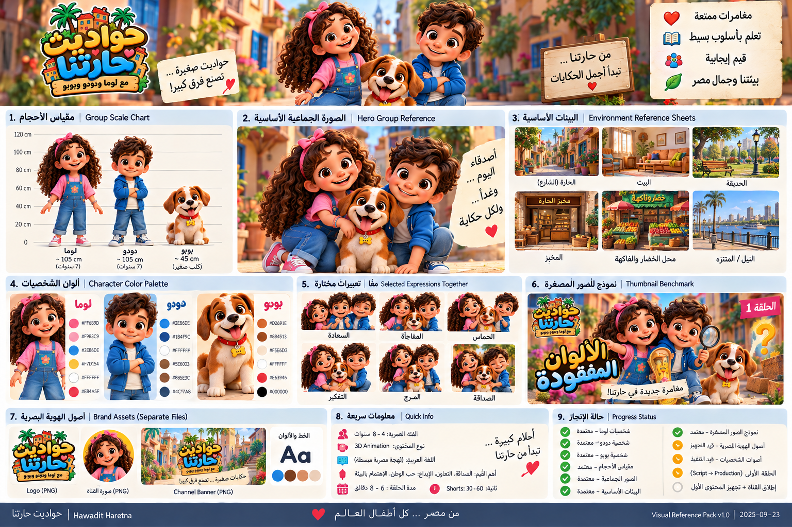

# مَرَح — القناة التعليمية | لوما ودودو وبوبو

<aside>
🎯

هدف مَرَح: تعليم الأطفال من 2–6 سنوات باللعب والمواقف اليومية المصرية مع لوما ودودو وبوبو؛ يكتسب الطفل معرفة بسيطة أو مهارة حياة قابلة للتطبيق، ويشارك ولي الأمر في نشاط قصير بعد المشاهدة. إصدار تعليمي V2 — 14 أكتوبر 2026.

</aside>

## هوية القناة

- **الفئة العمرية:** 2–6 سنوات
- النوع: كرتون تعليمي بالمواقف — هدف تعلم رئيسي واحد في كل فيديو، وترفيه وموسيقى يخدمان الفهم.
- **الأسلوب البصري:** Premium 3D Animation احترافي بجودة سينمائية، مع تصميم شخصيات أصلي ثابت، تعبيرات وجه قوية، بيئات غنية، إضاءة احترافية، حركة كاميرا مدروسة ومؤثرات بصرية متناسقة.
- **الشخصيات:** لوما 👧 — دودو 👦 — بوبو 🐶
- **مدة الحلقة المبدئية:** 2–4 دقائق
- **اللغة:** العربية باللهجة المصرية — لغة الحوار الأساسية والرسمية للقناة.
- **الهوية:** مصرية معاصرة أصيلة تظهر في العالم والشخصيات واللغة والموسيقى والحياة اليومية، بدون اختزال مصر في كليشيهات سياحية.

## أعمدة المحتوى

1. المعرفة الأساسية: الألوان والعد والمقارنة والأشكال والمكان والأصوات؛ نموذج واضح ثم محاولة ثم مثال جديد.
2. مهارات الحياة: النظافة والترتيب وتجهيز الاحتياجات والعناية بالأشياء؛ السلوك الصحيح يظهر بالفعل داخل يوم مصري مألوف.
3. التربية والمشاعر: الانتظار والمشاركة والاستئذان والاعتذار وإصلاح الأثر والتعبير عن الحزن وقبول الرفض؛ دون إهانة أو تخويف أو إجبار على إظهار الفرح.
4. السلامة والبيئة والانتماء: طلب مساعدة بالغ، الحفاظ على المكان واحترام الجيران والحيوان؛ الأغنية اختيارية للمراجعة ولا تحل محل التطبيق.

## معيار الجودة الإبداعية

- **Premium Kids Animation** وليس فيديوهات 3D بسيطة أو تجميعات AI عشوائية.
- Storytelling احترافي: Hook سريع → مشكلة/مغامرة → مشاركة الطفل → حل → مكافأة/نهاية مرضية.
- التعليم يكون داخل القصة بصورة طبيعية، وليس درسًا مباشرًا.
- موسيقى ومؤثرات صوتية وهوية بصرية متناسقة، مع السعي لمواد أصلية خاصة بالقناة.
- ثبات شكل وشخصية وصوت وحركة لوما ودودو وبوبو بين الحلقات.
- كل مشهد يخدم القصة أو التعلم أو التفاعل؛ لا حشو بصري.

## قاعدة الحلقة

قالب كل فيديو: هدف واحد → نتيجة تعلم قابلة للملاحظة → موقف يومي/مشكلة بسيطة → نموذج عملي من الشخصية → محاولة الطفل أو الشخصية → سؤال مع وقفة 2–3 ثوانٍ → جواب أو تصحيح لطيف → حل بالممارسة → نشاط مع ولي الأمر. لعمر 2–3 تكفي الإشارة والتقليد والاختيار من اثنين؛ لعمر 4–6 نضيف تسمية وتطبيقًا وشرحًا بسيطًا وفق قدرة الطفل. لا ادعاء أن مشاهدة حلقة تضمن اكتساب المهارة. التفاصيل المحدثة داخل Notes لكل بطاقة في Content Pipeline: 40 حلقة و60 Short.

## أول أفكار الحلقات

1. Where Is Number 5? — الأرقام 1–5.
2. Who Made That Sound? — الحيوانات وأصواتها.
3. Bobo Won’t Brush His Teeth! — تنظيف الأسنان.
4. The Fruit Hunt — الفواكه والألوان.
5. The Shape Adventure — الأشكال.
6. Where Is Bobo’s Toy? — فوق/تحت/داخل/خارج.
7. The Dirty Hands Monster — غسل اليدين.
8. Dodo and the Traffic Lights — إشارات المرور والسلامة.
9. Bobo Doesn’t Want to Sleep — روتين النوم.
10. The Missing Colors — الألوان الأساسية.

## مسار الإنتاج

هدف تعلم → brief تعليمي → سيناريو مصري مشكول نطقيًا → تسجيل منفصل للشخصيات ومراجعة النطق → صور مشاهد ثابتة → تحريك/مونتاج الصور → تركيب الحوار والمؤثرات والموسيقى → مراجعة تعليمية وبصرية وصوتية → نشر. شرط الاكتمال: حوار مسموع كامل، نطق مصري مراجع، تزامن مع المشهد، ثبات الشخصيات، وهدف يظهر في القصة.

## قاعدة التوثيق

هذه الصفحة هي **Single Source of Truth** للمشروع. أي قرار أو تعديل أو إضافة نتفق عليها أثناء تطوير القناة يتم تحديثها هنا بحيث تمثل الصفحة دائمًا أحدث نسخة معتمدة من المشروع.

## المرحلة الحالية — إصدار التعليم V2 | 14 أكتوبر 2026

- [x]  تحديد الفئة العمرية: 2–6.
- [x]  تحديد نوع المحتوى واللغة والهوية المصرية.
- [x]  تثبيت لوما ودودو وبوبو كشخصيات أساسية.
- [x]  اعتماد Canonical Character Designs.
- [x]  تنفيذ Character Turnarounds / Expressions / Poses / Details.
- [x]  رفع Character Reference images إلى Notion.
- [x]  اعتماد Group Scale / Hero Group / Environment / Thumbnail visual references v1.0.
- [x]  اختيار اسم القناة النهائي: مَرَح.
- [x]  اعتماد Brand Identity v1.0.
- [x]  كتابة Script V1 للحلقة التجريبية الأولى «الألوان المفقودة».
- [ ]  Script V2 النهائي باللهجة المصرية.
- [ ]  Storyboard + Animatic + Shot List.
- [ ]  Voice Tests واعتماد الأصوات.
- [ ]  3–5 Production Benchmark Shots.
- [ ]  إنتاج Pilot.
- [ ]  تجهيز Launch Buffer: 4 Long + 8 Shorts.

[Content Pipeline](../data/pipeline-view.csv)

[Production System — من الفكرة إلى فيديو جاهز للنشر](3e43ab32c4408128bf57ec67477930b1.md)

## نظام الإنتاج الرسمي

[Production System — من الفكرة إلى فيديو جاهز للنشر](3e43ab32c4408128bf57ec67477930b1.md)

هذا المرجع يحدد الـFlow الكامل، الأدوات، بوابات الجودة، وما الذي أتولاه في كل مرحلة.

[Creative Bible — الهوية المصرية والعالم والشخصيات](3e43ab32c4408153bc22f03d3c6acda9.md)

[Voice Bible — الهوية الصوتية المصرية](3e43ab32c44081bb939ee71de620efe0.md)

# Brand Name Lock — مَرَح | 14 أكتوبر 2026

<aside>
🏡

الاسم الرسمي المعتمد للقناة: مَرَح

</aside>

Brand line: مَرَح — مع لوما ودودو وبوبو

**جوهر الاسم:** كل حلقة هي حدوتة جديدة داخل الحي المصري الخيالي المعاصر الخاص بلوما ودودو وبوبو؛ الاسم يسمح بالتعليم والمغامرات والأغاني والعادات اليومية والمحتوى الثقافي تحت Brand واحد.

**Intro line المقترحة المعتمدة كبداية:** «يلا بينا نشوف... حكاية النهارده في حارتنا!»

## Brand Naming Rules

- الاسم العربي الرئيسي يظهر: مَرَح.
- أسماء الشخصيات تظهر كـSub-brand عند الحاجة: **مع لوما ودودو وبوبو**.
- لا يتم تغيير الاسم أو ترجمته كاسم أساسي داخل الهوية العربية بدون قرار Brand جديد.
- تصميم الـLogo والـBanner والـIntro يجب أن ينطلق من فكرة الحارة المصرية الدافئة والمبهجة، وليس من كليشيهات الأهرامات/الفراعنة.
- قبل التسجيل القانوني أو شراء نطاق/Handles تجارية، يلزم فحص Trademark/Handle رسمي منفصل؛ البحث العام الحالي ليس فحص ملكية قانونيًا.

## الحالة

- [x]  اسم القناة النهائي — مَرَح.
- [x]  Brand positioning.
- [x]  Sub-brand line.
- [x]  Intro phrase baseline.
- [x]  Logo visual concept/direction.
- [x]  Channel Banner visual concept/direction.
- [x]  Profile Icon visual concept/direction.
- [x]  Visual Reference Pack v1.0 مضاف فعليًا إلى الصفحة الرئيسية.
- [ ]  إخراج Logo/Banner/Profile كملفات Production مستقلة بالمقاسات النهائية.
- [ ]  Intro/Outro motion files.
- [ ]  Social/YouTube handle availability check at registration time.

# Brand Visual Identity Lock — اعتماد الهوية البصرية

<aside>
🎨

تم اعتماد لوحة الهوية البصرية الأخيرة كـMaster Brand Direction لقناة «مَرَح». تُستخدم كمرجع إلزامي عند تنفيذ الشعار، صورة القناة، البانر، الـThumbnails والمواد الترويجية.

</aside>

## Logo — Approved Direction

- Wordmark عربي مرح وثقيل ومستدير لاسم مَرَح.
- مرجع الاسم الحالي: مَرَح. تُراجع كتابة الشعار لهذا الاسم قبل الاعتماد؛ توزيع ألوان الكلمات السابق خاص بالاسم القديم ويُلغى.
- خلف الشعار عناصر مبسطة من الحارة المصرية: بيوت دافئة + نخيل/نباتات.
- Hearts/details صغيرة مسموحة كعناصر مساعدة وليست محور الشعار.
- Sub-brand عند الحاجة: **مع لوما ودودو وبوبو**.
- يجب توفير نسخة Full Logo + Simplified Logo + Monochrome/limited-color عند التنفيذ النهائي.

## Profile Picture — Approved Direction

- لوما + دودو + بوبو معًا في Crop دائري قريب.
- وجوه كبيرة وواضحة وابتسامات طبيعية.
- الشعار يظهر فقط إذا ظل مقروءًا على الحجم الصغير؛ الأولوية للوجوه.
- Background مصري دافئ وبسيط بدون تفاصيل تزاحم الشخصيات.

## Channel Banner — Approved Direction

- الشخصيات الثلاثة Hero في حارة مصرية معاصرة.
- الغلاف الحالي بدون اسم أو شعار أو كتابة، وفق اختيار صاحب القناة؛ الشخصيات الثلاثة داخل المساحة الآمنة.
- يمكن استخدام النيل/المراكب/المئذنة/النخيل كإشارات مصرية طبيعية عند ملاءمتها، بدون تحويل الهوية إلى كليشيه سياحي.
- الرسالة الأساسية: مغامرات + تعلم + أغاني + قيم جميلة.
- يجب مراعاة YouTube Safe Area عند إنتاج النسخة النهائية.

## Brand Palette — Direction Locked

- Warm Golden Orange — اللون الدافئ الأساسي.
- Egyptian/Nile Blue — اللون الأزرق الأساسي.
- Luma Pink — Accent.
- Natural Green — Accent للعالم والنباتات.
- Warm Brown — الخشب/الحارة/بوبو.
- Soft Cream — الخلفيات الهادئة.

الألوان الرقمية النهائية تُستخرج من Master Assets التنفيذية لضمان الاتساق ولا تعتمد على قراءة آلية تقريبية من صورة Concept.

## Typography Direction

- Display Arabic: Rounded, bold, playful, highly readable.
- Supporting Arabic: Friendly clean Arabic typeface بوضوح ممتاز على الهاتف.
- لا خطوط رفيعة أو زخارف معقدة في مواد الأطفال.
- Logo lettering يمكن أن يكون Custom Lettering خاصًا بالبراند.

## Thumbnail Style — Approved

- شخصيات كبيرة + Emotion واضحة + موضوع الحلقة ظاهر فورًا.
- ألوان قوية ودافئة.
- 1–3 شخصيات في مركز الاهتمام.
- نص عربي قصير جدًا عند الحاجة.
- نفس لغة العالم والشخصيات المعتمدة؛ ممنوع استخدام تصميمات بديلة للشخصيات لجذب النقرات.
- كل Thumbnail يجب أن يكون صادقًا مع محتوى الحلقة.

## Brand Values

**مغامرة ممتعة — تعلم بسيط — قيم إيجابية — بيتنا وجمال مصر — محتوى آمن للأطفال.**

## Supporting Visual Assets

يمكن استخدام: لافتات خشبية، نباتات وأصيص، فوانيس شارع مصرية معاصرة، قطط الحارة كشخصيات Background غير أساسية، واجهات البيوت الملونة، عناصر طبيعية من الحي.

## Brand Footer / Signature Direction

**من مصر... لأطفال العالم** يمكن استخدامها كـBrand Signature ثانوية في المواد المناسبة، وليست إلزامية في كل فيديو.

## حالة الهوية

- [x]  Channel name.
- [x]  Brand positioning.
- [x]  Logo visual direction.
- [x]  Profile picture direction.
- [x]  Banner direction.
- [x]  Brand palette direction.
- [x]  Typography direction.
- [x]  Thumbnail system direction.
- [x]  Brand values.
- [x]  Supporting visual language.
- [ ]  تصدير الأصول النهائية بالمقاسات والصيغ المطلوبة للمنصات.
- [ ]  Intro/Outro motion execution.
- [ ]  Handle availability / trademark check عند التسجيل.

# Brand Identity v1.0 — Production Specification

<aside>
✅

**الحالة:** Brand Identity v1.0 معتمدة وجاهزة للانتقال إلى الإنتاج. لوحة الهوية الأخيرة هي الـMaster Reference البصري.

</aside>

## Deliverables & Export Specs

### Primary Logo

- Full-color master، Transparent background.
- PNG: 3000px+ عرض.
- SVG/Vector عند إعادة بناء الـlettering كـVector.
- نسخ: Full / Horizontal / Simplified / Single-color light / Single-color dark.

### Channel Profile

- Master: **800 × 800 px** PNG.
- تصميم آمن داخل دائرة القص.
- الوجوه الثلاثة هي الأولوية في الأحجام الصغيرة.

### YouTube Channel Banner

- Master canvas: **2560 × 1440 px**.
- جميع العناصر المهمة — Logo/characters/core copy — داخل الـSafe Area المركزي وفق أحدث متطلبات YouTube وقت الرفع.
- JPG/PNG بجودة عالية وحجم ملف مطابق لمتطلبات المنصة وقت النشر.

### Thumbnail Master

- **1280 × 720 px / 16:9** كـProduction Master baseline.
- PNG/JPG high quality.
- Face + episode object/problem + short Arabic copy when needed.

### Favicon / Small Mark

- Simplified neighborhood/letter mark بدون تفاصيل دقيقة.
- Masters: 512 × 512 و32 × 32 عند الحاجة خارج YouTube.

## Brand Colors v1.0

قيم التشغيل المعتمدة من لوحة الهوية:

- Golden Orange: **#F9B233**
- Nile Blue: **#2E86DE**
- Luma Pink: **#FF6B90**
- Natural Green: **#58B368**
- Warm Brown: **#8B5E3C**
- Soft Cream: **#F4E6D7**

تُستخدم كـBrand tokens، مع السماح بتدرجات إضاءة سينمائية داخل الرسوم دون تغيير هوية اللون الأساسية.

## Typography v1.0

- Display direction: Arabic rounded/bold/playful.
- Working title font direction: **Cairo Rounded / Bold أو أقرب بديل مرخص يحقق نفس الشكل**.
- Body/supporting direction: **Cairo / Regular أو بديل مرخص واضح**.
- Custom logo lettering هو المرجع الأعلى للشعار؛ الخطوط النصية لا تستبدل رسم الشعار.

# Intro v1.0 — 10 seconds

**0:00–0:02** Establishing shot للحارة المصرية؛ Camera move لطيف، أصوات صباح/عصافير، جملة: «يلا بينا نشوف...»

**0:02–0:05** Logo reveal بحركة مرحة مع Musical sting أصلي قصير.

**0:05–0:08** لوما ودودو وبوبو يدخلون/يجرون نحو الكاميرا؛ الجملة: «حكاية النهارده في حارتنا!»

**0:08–0:10** Quick transition إلى الحلقة؛ Brand signature الموسيقية تنتهي بدون تعطيل الـHook.

- Format Master: 1920 × 1080، 16:9.
- يجب أيضًا إنتاج نسخة مختصرة 3–5 ثوانٍ بعد اختبار Retention إذا لزم.
- لا نسمح للمقدمة أن تصبح حاجزًا متكررًا أمام بداية القصة؛ يمكن بدء بعض الحلقات بـCold Open ثم Sting قصير.

# Outro v1.0 — 8 seconds

**0:00–0:03** الثلاثة يودعون الطفل داخل الحارة؛ «شكرًا لمشاهدتكم!» أو صياغة حلقة مناسبة.

**0:03–0:08** مساحة بصرية نظيفة لعناصر نهاية YouTube، مع موسيقى الـTheme الخفيفة.

- لا نعتمد نصوص CTA أو عناصر تفاعلية ثابتة إلا بما يتوافق مع خصائص المحتوى الموجه للأطفال وسياسات YouTube الحالية وقت النشر.
- Master: 1920 × 1080، 16:9.

# Channel Copy v1.0

Channel Name: مَرَح

**Sub-brand:** مع لوما ودودو وبوبو

**Signature:** من مصر... لأطفال العالم ❤️

Short Description: «مَرَح» عالم مصري دافئ من المغامرات والقصص والأغاني التعليمية مع لوما ودودو وبوبو؛ نكتشف، نلعب ونتعلم في حكايات ممتعة وآمنة للأطفال.

**Language:** Arabic — Egyptian dialect.

**Audience:** 2–6 years.

**Category direction:** Kids / Film & Animation / Educational entertainment حسب خيارات YouTube المتاحة وقت الإنشاء.

# Handle Strategy

الأولوية عند إنشاء القناة:

1. @HawaditHaretna
2. @Hawadit.Haretna إذا كانت المنصة تسمح والصيغة متاحة.
3. @HawaditHaretnaKids
4. @HaretnaKids

لا يُسجل أي Handle على أنه «متاح» في الوثائق إلا بعد التحقق الفعلي داخل المنصة لحظة الحجز.

# Trademark / Ownership Gate

- الاسم والهوية معتمدان إبداعيًا داخل المشروع.
- قبل Trademark/merchandising/ترخيص واسع: فحص قانوني للاسم والشعار في الفئات والأسواق المستهدفة.
- حفظ ملفات المصدر وتواريخ الإنشاء وإثباتات تراخيص الخطوط/الموسيقى/الأصوات والأصول.
- أي Asset مولّد أو خارجي يدخل Rights Ledger قبل الاستخدام التجاري النهائي.

# Final Branding Status

- [x]  اسم القناة.
- [x]  Logo direction + variants specification.
- [x]  Profile specification.
- [x]  Banner specification.
- [x]  Brand color tokens.
- [x]  Typography system.
- [x]  Thumbnail system.
- [x]  Intro storyboard/timing.
- [x]  Outro storyboard/timing.
- [x]  Channel copy.
- [x]  Handle strategy.
- [x]  Export specification.
- [x]  Rights/Trademark gate defined.
- [ ]  إخراج ملفات الـLogo/Avatar/Banner كملفات منفصلة نهائية عند مرحلة Upload.
- [ ]  تحريك Intro/Outro كفيديو نهائي أثناء Production.
- [ ]  حجز الـHandle فعليًا عند إنشاء القناة.
- [ ]  Trademark legal clearance إذا تقرر تسجيل العلامة.

**Brand Foundation = LOCKED.** المتبقي في البنود غير المؤشرة أعمال تنفيذ/رفع/تسجيل خارج قرار الهوية، وليست قرارات تأسيسية مفتوحة.

# Production Decision Board v1.0 — اعتماد عينات ما قبل الإنتاج

<aside>
🔒

**APPROVED / LOCKED — 23 Sep 2026:** تم رفع لوحة العينات الشاملة إلى الصفحة الرئيسية واعتمادها كمرجع لاتجاه مرحلة ما قبل الإنتاج. تستخدم مع Creative Bible وCharacter Reference Pack، ولا تستبدل المواصفات الرقمية والنصية الدقيقة عند وجود اختلاف في نص مولّد داخل الصورة.

</aside>

## ما تم حسمه بصريًا

- [x]  الشكل الجماعي النهائي للوما ودودو وبوبو.
- [x]  عينات التعبيرات واتجاه الأداء الوجهي.
- [x]  اتجاه Scale بين الشخصيات؛ المرجع الرقمي المكتوب في Creative Bible هو الحاكم عند اختلاف أرقام الصورة.
- [x]  اتجاه Logo / Profile / Banner.
- [x]  اتجاه مواقع العالم: الحارة، البيت، الحديقة، المخبز، محل الخضار والفاكهة، النيل/المتنزه.
- [x]  اتجاه Thumbnail للحلقة الأولى.
- [x]  اتجاه Storyboard البصري للحلقة الأولى.
- [x]  اتجاه Voice Casting: لوما دافئة/واضحة/فضولية، دودو حيوي/فضولي، بوبو أداء غير لفظي معبّر.
- [x]  Production Flow من Script حتى Final QA.
- [x]  Launch direction: إنتاج Buffer قبل الإطلاق.

## EP01 — Visual Story Direction

**العنوان:** الألوان المفقودة.

**الهدف التعليمي:** الألوان الأساسية، مع تثبيت الهدف النهائي في Script V2.

**اتجاه المشاهد من لوحة العينات:**

1. Hook / اكتشاف المشكلة الغامضة.
2. بداية المغامرة في الحارة.
3. تفاعل مع أحد سكان/أماكن الحارة عند الحاجة للقصة.
4. العثور على أول دليل/لون.
5. مشاركة الطفل والبحث/اللعب.
6. Payoff سعيد وعودة الألوان.

> هذه اللوحات **Concept Story Beats** وليست Shot List أو Timing نهائيًا. التوقيت والحوار داخل الصورة المولدة لا يُعاملان كـProduction Truth قبل Script V2 والـAnimatic.
> 

## Voice Direction — Locked for Testing

- **Luma:** صوت طفولي مصري دافئ، واضح، فضولي، هادئ نسبيًا، بابتسامة مسموعة.
- **Dodo:** صوت طفولي مصري حيوي، أسرع قليلًا، فضولي ومتحمس بدون صراخ دائم.
- **Bobo:** نباح/همهمات/أصوات كلب لطيفة ومعبرة؛ لا جمل بشرية في الوضع الأساسي.
- الخطوة التنفيذية التالية: إنتاج 2–3 Voice Tests لكل شخصية ثم اختيار Canonical Voice.

## Production Route — Approved Sequence

**Script V2 → Storyboard → Animatic → Voice Recording → Benchmark Shots → Production → Edit + Music/SFX → Thumbnail → QA + Final Master.**

لا يبدأ Full Production قبل اجتياز Benchmark Shots واختبار ثبات الشخصيات والعالم والحركة.

## Launch Gate

قبل Public Launch:

- [ ]  Brand exports النهائية.
- [ ]  إنشاء القناة وحجز Handle فعلي.
- [ ]  Channel settings/copy/artwork.
- [ ]  4 Long Episodes مكتملة.
- [ ]  8 Shorts جاهزة.
- [ ]  Rights Ledger مكتمل لكل Asset مستخدم.
- [ ]  EP01 Final QA ناجح.

## Current Project Gate

**FOUNDATION / VISUAL DIRECTION: LOCKED.**

**CURRENT ACTIVE PHASE: EP01 PRE-PRODUCTION.**

الخطوة التالية الرسمية: **Script V2 باللهجة المصرية** ثم Storyboard وAnimatic، بالتوازي مع Voice Tests وإعداد Benchmark Shots.

## QA Note for AI-generated Boards

أي كتابة عربية، تاريخ، Hex code، قياس، مدة أو رقم يظهر داخل صورة مولدة بالذكاء الاصطناعي يعتبر **Illustrative فقط** ما لم يطابق النص المعتمد في Notion. ترتيب المرجعية:

1. المواصفات النصية/الرقمية المعتمدة في Notion.
2. Canonical Character Reference images.
3. Production Decision Board / Visual Reference Pack.
4. Concepts الأقدم.