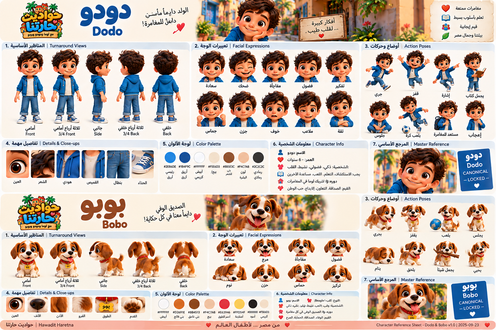
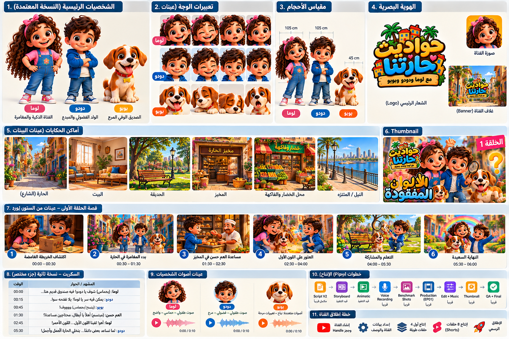

# Creative Bible — الهوية المصرية والعالم والشخصيات

<aside>
🇪🇬

**القرار الإبداعي الرسمي:** القناة علامة أطفال مصرية معاصرة من حيث اللغة والروح والتفاصيل اليومية، وليست قالبًا عالميًا تمت إضافة رموز مصرية فوقه. الهوية المصرية تظهر طبيعيًا في الشخصيات والعالم والموسيقى والمواقف، مع بقاء المحتوى سهل الفهم وممتعًا للطفل.

</aside>

# Creative North Star

**Premium Egyptian Kids Animation**

- Premium stylized 3D + Cinematic Storytelling.
- كوميديا دافئة، فضول، مغامرة، موسيقى وتعليم غير مباشر.
- مصرية معاصرة ومرحة، بدون كليشيهات سياحية أو مبالغة في التراث.
- العالم آمن، مشرق، نظيف، غني بالتفاصيل وقابل للتوسع.
- الفئة الأساسية: 2–6 سنوات. مدة الحلقة الأساسية: 3–5 دقائق.

# اللغة

- **اللغة الرسمية:** العربية باللهجة المصرية.
- جمل قصيرة وطبيعية وسهلة النطق والفهم.
- تجنب العامية الصعبة والألفاظ المحلية الغامضة.
- الكلمات التعليمية تُقال بالعربية أولًا.
- الإنجليزية لا تُستخدم تلقائيًا؛ تُضاف فقط إذا كان هدف الحلقة تعليم كلمة إنجليزية.
- مخاطبة الطفل مباشرة مع Pause مناسبة للإجابة.

# الشخصيات الأساسية

## لوما

**الدور:** قلب الفريق والملاحِظة الذكية.

- العمر الظاهري: نحو 6 سنوات.
- فضولية، واثقة بدون تعالٍ، حنونة، تحب اكتشاف سبب الأشياء.
- تلاحظ الأدلة وتربط المعلومات وتشجع الطفل على التفكير.
- كلام مصري بسيط وهادئ وواضح؛ حركة نشيطة محسوبة وتعبيرات دافئة.
- طفلة مصرية معاصرة بملامح أصلية وشعر داكن وملابس عملية ملونة.
- **ممنوع:** أن تعرف كل الإجابات دائمًا أو تتحول لشخصية وعظية.

## دودو

**الدور:** المحرك الفضولي للمغامرة.

- العمر الظاهري: نحو 5 سنوات.
- متحمس، سريع التجربة، يسأل كثيرًا، شجاع لكنه قد يتسرع.
- يبدأ التجربة ويطرح السؤال الذي قد يدور في ذهن الطفل.
- كلام مصري تلقائي وحيوي؛ حركة وردود فعل أسرع من لوما.
- طفل مصري معاصر بملامح أصلية وSilhouette واضح مختلف عن لوما.
- **ممنوع:** جعله غبيًا أو مصدر الخطأ دائمًا.

## بوبو

**الدور:** الكوميديا والقلب العاطفي غير اللفظي.

- كلب صغير ودود، فضولي ومعبّر.
- يعتمد على النباح والأصوات والنظرات والأذنين والذيل والحركة الجسدية.
- قد يكتشف دليلًا بالمصادفة أو يخلق موقفًا مضحكًا يدفع القصة.
- **لا يتحدث كإنسان في الوضع الأساسي.**
- Silhouette بسيط ومميز وقابل للتحريك والمنتجات مستقبلًا.
- ممنوع الكوميديا المؤذية أو التخويف أو الفوضى بلا وظيفة.

# ديناميكية الثلاثي

**لوما تلاحظ → دودو يجرب → بوبو يفاجئ → الطفل يشارك → الثلاثة يصلون للحل.**

نبدل من يقود الحل بين الحلقات حتى لا تصبح القصص متوقعة.

# العالم المصري

العالم الأساسي **حي مصري خيالي معاصر** مستوحى من الحياة اليومية، وليس مدينة حقيقية محددة.

## مواقع متكررة

- بيت عائلي دافئ.
- شارع هادئ وآمن للمشاة.
- حديقة الحي.
- مخبز/فرن محلي لطيف.
- محل فاكهة وخضار.
- مكتبة/مساحة تعلم.
- منطقة لعب.

## لغة التصميم

- شرفات، نباتات، خامات، أبواب ونوافذ ولمسات معمارية مصرية معاصرة.
- العربية تظهر طبيعيًا في اللافتات عند الحاجة مع مراجعة النص قبل الاعتماد.
- ألوان دافئة مستوحاة من الشمس والحجر والطبيعة مع ألوان شخصيات واضحة.
- **الأهرامات والجمال والفراعنة ليست الخلفية الدائمة**؛ تظهر فقط عندما تكون القصة عنها.

# الثقافة والحياة اليومية

ندمج الأسرة والجيرة والمشاركة والطعام والأسواق والحضانة والحدائق والمناسبات بصورة عضوية. التراث مادة قصصية وليس ديكورًا إلزاميًا. المناسبات الدينية والثقافية تحصل على حلقات مخصصة ومدروسة.

# الموسيقى والصوت

- مرحة، دافئة، حديثة، مصرية الروح.
- ألوان إيقاعية وآلات مستوحاة من الموسيقى المصرية مع إنتاج أطفال حديث.
- لا تتحول الموسيقى إلى فولكلور دائم.
- Theme قصير قابل للتذكر + Motifs للشخصيات.
- الأغاني أصلية أو ذات حقوق استخدام واضحة.

# Visual Rules

- Stylized 3D بنسب طفولية جذابة وليست واقعية.
- تعبيرات قابلة للقراءة سريعًا وخامات نظيفة بدون Hyper-realism.
- Cinematic lighting مع وضوح الوجه والألوان.
- Camera على مستوى الطفل غالبًا وحركتها لها سبب قصصي.
- لا تغيير في الوجه أو لون البشرة أو الشعر أو الملابس الأساسية أو نسب الجسم بين اللقطات بلا سبب معتمد.
- Character Turnaround + Expression Sheet + Pose Sheet + Color/Material references قبل الإنتاج.

# Story Formula

**0–10 ثوانٍ:** Hook بصري/سؤال/مشكلة.

**Act 1:** اكتشاف المشكلة.

**Act 2:** محاولات + لعب + مشاركة الطفل + كوميديا.

**Act 3:** اكتشاف/تعلم يؤدي للحل.

**Payoff:** مكافأة بصرية/عاطفية.

**Outro:** لحظة قصيرة قابلة للتذكر.

الهدف التعليمي الأساسي واحد لكل حلقة.

# Safety & Tone

- لا عنف واقعي، رعب، إذلال، تنمر أو سخرية جارحة.
- الخطر إن وجد بسيط ومفهوم ومحلول بأمان.
- لا تخويف الطفل للحصول على سلوك صحيح.
- الأخطاء جزء طبيعي من التعلم.
- البالغون، عند ظهورهم، داعمون وليسوا وعاظًا دائمين.

# قرارات مقفلة

- [x]  الفئة: 2–6.
- [x]  اللغة: العربية المصرية.
- [x]  الهوية: مصرية معاصرة.
- [x]  الجودة: Premium stylized 3D cinematic.
- [x]  الأبطال: لوما + دودو + بوبو.
- [x]  التعليم داخل القصة.
- [x]  بوبو غير ناطق أساسًا.
- [x]  العالم: حي مصري خيالي معاصر قابل للتوسع.
- [x]  الموسيقى: حديثة مصرية الروح وليست فولكلورًا دائمًا.
- [x]  هدف تعليمي رئيسي واحد لكل حلقة.

# Visual Execution Status — الحالة الحالية

- [x]  Canonical Character Designs للوما ودودو وبوبو.
- [x]  Character Turnarounds للشخصيات الثلاثة.
- [x]  Expression + Pose/Movement Sheets.
- [x]  الملابس الأساسية والألوان والخامات والـSignature Elements.
- [x]  اسم القناة النهائي: **حواديت حارتنا**.
- [x]  Brand/Logo direction معتمد ضمن Brand Identity v1.0.
- [x]  Character Reference Sheets مرفوعة داخل هذه الصفحة كمرجع بصري فعلي.
- [x]  Group Scale visual reference v1.0.
- [x]  Hero Group Reference v1.0.
- [x]  Environment visual direction reference v1.0 للمواقع الأساسية.
- [x]  Thumbnail Benchmark concept v1.0.
- [x]  Brand Asset visual concepts: Logo / Avatar / Banner.
- [ ]  فصل الأصول السابقة إلى ملفات Production مستقلة بالمقاسات النهائية.
- [ ]  Environment Sheets منفصلة عالية الدقة لكل Location.
- [ ]  Thumbnail Benchmark نهائي بعد اختبار القراءة على المقاسات الصغيرة.

# تحديث الاتجاه البصري المعتمد — 23 سبتمبر 2026

<aside>
✨

**الأسلوب البصري المعتمد:** Premium Cute Cinematic Egyptian 3D بجودة Feature Animation. الهدف أن تكون الشخصيات جميلة وجذابة جدًا من أول Frame، مع تعبيرات قوية ووضوح ممتاز في الـThumbnail، مع الحفاظ على تصميمات أصلية خاصة بالقناة.

</aside>

## لوما — Visual Direction Approved

- الاتجاه البصري الذي اختاره المستخدم للوما **معتمد**.
- نحافظ في التطوير النهائي على جمال الوجه، الـCute Factor، جودة الـ3D، التعبيرات السينمائية والهوية المصرية المعاصرة.
- التصميم النهائي سيكون أصليًا خاصًا بلوما ومتسقًا في كل الحلقات.

## دودو — Visual Direction Approved

- الاتجاه البصري الذي اختاره المستخدم لدودو **معتمد**.
- نفس مستوى Premium Cute Cinematic الخاص بلوما، مع Silhouette وتعبيرات وشخصية بصرية مستقلة.
- التصميم النهائي سيكون أصليًا خاصًا بدودو ومتسقًا في كل الحلقات.

## بوبو — Visual Direction Approved

- **الاختيار رقم 4 من مجموعة مراجع بوبو هو الاتجاه البصري المعتمد.**
- المطلوب: Puppy شديد الجاذبية، Premium stylized 3D، وجه وتعبيرات محببة، ومتناسق في الجودة مع لوما ودودو.
- المرجع يحدد **لغة التصميم والجودة والـCute Factor**؛ التصميم النهائي لبوبو سيكون شخصية أصلية خاصة بالقناة.

## قواعد الجاذبية البصرية

- الشخصيات الثلاثة يجب أن تكون قابلة للتعرّف فورًا من الـSilhouette والوجه.
- جمال الشخصية ووضوح تعبيرها في اللقطات والـThumbnails أولوية تصميمية.
- لا Hyper-realism ولا مبالغة Baby-like.
- ثبات الوجه، لون البشرة/الفرو، الشعر، النسب، الملابس والخامات إلزامي بعد اعتماد الـCanonical Design.

## المتبقي بصريًا — Updated

- [x]  اتجاهات وتصميمات الشخصيات الثلاثة.
- [x]  Character Turnarounds / Expressions / Poses / Details.
- [x]  الملابس والألوان والخامات الأساسية.
- [x]  اسم القناة: **حواديت حارتنا**.
- [x]  Brand/Logo visual direction.
- [x]  Character Reference images داخل Notion.
- [x]  Group Scale Reference v1.0.
- [x]  Hero Group Reference v1.0.
- [x]  Environment Direction Reference v1.0.
- [x]  Thumbnail Benchmark Concept v1.0.
- [x]  Logo / Avatar / Banner visual concepts.
- [ ]  استخراج Group Scale كـProduction Sheet مستقل ونظيف.
- [ ]  استخراج Hero Group كصورة Canonical مستقلة.
- [ ]  إنتاج Environment Sheet مستقل لكل موقع.
- [ ]  إخراج Logo / Avatar / Banner كملفات نهائية منفصلة بالمقاسات المعتمدة.
- [ ]  Thumbnail benchmark نهائي بعد اختبار الحجم الصغير.

# Canonical Character Lock — الشخصيات المعتمدة

<aside>
🔒

**قرار نهائي:** تم اعتماد الاتجاهات البصرية الحالية للوما ودودو، واعتماد التصميم الأصلي المُولّد لبوبو كمرجع Canonical. أي إنتاج لاحق يجب أن يحافظ على الهوية والنسب والألوان والملامح الأساسية. التغيير الجوهري يحتاج قرارًا جديدًا موثقًا.

</aside>

## لوما — Canonical Identity

- طفلة مصرية معاصرة، العمر الظاهري نحو 6 سنوات.
- **Visual Direction مقفول:** Premium Cute Cinematic Egyptian 3D / Feature Animation Quality.
- ملامح طفولية جميلة وودودة، شعر داكن، تعبيرات وجه دافئة وقابلة للقراءة سريعًا.
- حضورها البصري: ذكية، مطمئنة، فضولية وليست متعالية.
- الملابس: مصرية معاصرة وعملية وملونة، بدون تحويل الهوية المصرية إلى زي تراثي دائم.
- الحركة: نشيطة لكن محسوبة؛ Gesture واضح ونظيف.
- يجب الحفاظ على شكل الوجه والشعر ولون البشرة والنسب بعد إنشاء الـTurnaround النهائي.

## دودو — Canonical Identity

- طفل مصري معاصر، العمر الظاهري نحو 5 سنوات.
- **Visual Direction مقفول:** Premium Cute Cinematic Egyptian 3D / Feature Animation Quality.
- جميل وجذاب بصريًا مثل لوما لكن بوجه وSilhouette مستقلين.
- حضوره البصري: حيوي، فضولي، سريع التفاعل ومحبوب.
- الملابس: حديثة ومريحة وذات Palette تميزه بوضوح عن لوما.
- الحركة: أسرع وأكثر اندفاعًا قليلًا، مع تعبيرات أكبر دون مبالغة.
- يجب الحفاظ على شكل الوجه والشعر ولون البشرة والنسب بعد إنشاء الـTurnaround النهائي.

## بوبو — Canonical Design LOCKED

**المرجع النهائي:** التصميم الأصلي الذي تم إنشاؤه واعتماده في المحادثة بتاريخ 23 سبتمبر 2026.

- Puppy صغير، شديد الجاذبية، Premium stylized cinematic 3D.
- فرو أساسي **بني دافئ + أبيض**.
- شريط أبيض واضح في منتصف الوجه من الجبهة إلى الخطم.
- خطم وصدر وأجزاء من الأرجل باللون الأبيض.
- أذنان بنيتان متدليتان وكبيرتان نسبيًا، وتستخدمان في التعبير.
- عينان بنيتان كبيرتان داكنتان، لامعتان ومعبرتان.
- أنف صغير داكن مستدير.
- جسم صغير متوازن، أرجل قصيرة نسبيًا، كفوف واضحة، وذيل نشيط.
- فرو Soft متوسط التفاصيل: غني بصريًا لكن غير Hyper-realistic.
- **الطوق الأساسي:** أحمر مع تفاصيل معدنية دافئة.
- **Tag:** عظمة صغيرة ذهبية تحمل اسم «بوبو».
- Silhouette يجب أن يظل واضحًا في اللقطات الصغيرة والـThumbnail.
- تعبيراته الأساسية: سعيد، متحمس، فضولي، مندهش، مضحك، حزين بلطف، نائم/هادئ.
- الحركة: قفزات قصيرة، ميل الرأس عند الفضول، حركة ذيل واضحة، الأذنان جزء أساسي من الأداء.
- لا يتحدث كإنسان؛ الأداء يعتمد على النباح والأصوات والحركة والتعبير.
- **ممنوع:** تغيير توزيع ألوان الفرو، شكل الوجه الأساسي، نوع الأذنين، لون الطوق الأساسي أو نسب الجسم من Shot لآخر.

## قاعدة الاتساق بين الثلاثة

- نفس Render Language ونفس مستوى الخامات والإضاءة.
- Cute Factor مرتفع لكن بدون مبالغة Baby-like.
- العيون والتعبيرات مقروءة سريعًا.
- لا Character Drift بين الحلقات.
- كل شخصية لها Silhouette وPalette وسلوك حركي مميز.
- الهوية المصرية تظهر طبيعيًا في الملامح والملابس والعالم، لا عبر رموز تراثية إجبارية.

## Character Asset Pack — Current Status

- [x]  Luma Turnaround: Front / 3⁄4 / Side / 3⁄4 Back / Back.
- [x]  Dodo Turnaround: Front / 3⁄4 / Side / 3⁄4 Back / Back.
- [x]  Bobo Turnaround: Front / 3⁄4 / Side / 3⁄4 Back / Back.
- [x]  Expression References للشخصيات الثلاثة.
- [x]  Pose/Movement References للشخصيات الثلاثة.
- [x]  Color + Detail References.
- [x]  Canonical Master Reference لكل شخصية.
- [x]  Character Reference Sheets محفوظة بصريًا داخل Notion.
- [ ]  Scale Chart مستقل للثلاثة بجانب بعض.
- [ ]  Hero Group Shot مستقل.
- [ ]  Thumbnail readability test مستقل.
- [ ]  تجهيز نسخ Reference منفصلة محسّنة للإدخال في أدوات Animation/Video حسب متطلبات الأداة المختارة.

## حالة القرار

- [x]  لوما — الهوية والتصميم والـReference Sheet معتمدة.
- [x]  دودو — الهوية والتصميم والـReference Sheet معتمدة.
- [x]  بوبو — الهوية والتصميم والـReference Sheet معتمدة.
- [x]  أسلوب الرندر العام معتمد.
- [x]  Turnaround / Expressions / Poses / Details موثقة بصريًا.
- [x]  الصور المرجعية مضافة فعليًا إلى Notion.
- [ ]  Group/Scale وEnvironment production references ما زالت مطلوبة.

# Visual System Final Lock — اعتماد العينة النهائية

<aside>
✅

**العينة الجماعية الأخيرة معتمدة كـMaster Visual Target للمشروع.** أي Character Sheet أو Environment أو Thumbnail أو Shot جديد يجب أن يطابق لغة التصميم والجودة الظاهرة فيها.

</aside>

## لوما — Final Visual Specification

- شعر بني داكن كثيف ومجعد، بطول متوسط/طويل، مع Bow وردي مميز.
- عيون بنية كبيرة دافئة، حواجب واضحة، وجه طفولي مستدير وتعبيرات مرحة.
- لون بشرة مصري دافئ.
- Outfit أساسي: Pink top + denim overalls، مع حذاء رياضي مناسب للحركة.
- **Primary identity color:** Pink.
- الشخصية بصريًا: مبدعة، طيبة، فضولية وتحب الاكتشاف.
- الـBow + curls + Pink palette عناصر Signature لا تُحذف في الـDefault Look.

## دودو — Final Visual Specification

- شعر بني داكن كثيف ومموج/مجعد بخصل واضحة.
- عيون بنية كبيرة ووجه طفولي مبتسم.
- لون بشرة مصري دافئ متناسق مع لوما.
- Outfit أساسي: Blue hoodie/jacket فوق طبقة داخلية فاتحة + shorts/ملابس حركة + sneakers.
- **Primary identity color:** Blue.
- الشخصية بصريًا: فضولي، شجاع، يحب التعلم والتجربة.
- Hair silhouette + Blue outer layer عناصر Signature في الـDefault Look.

## بوبو — Final Visual Specification

- التصميم الـCanonical السابق مستمر بدون تغيير.
- Brown + White fur، white facial blaze، floppy brown ears، large dark-brown eyes.
- Red collar + golden bone name tag.
- **Accent identity:** warm orange/brown + red collar.
- مرح، وفي، متحمس، ذكي ويحب الجميع.

## Scale & Group Composition

- لوما الأطول قليلًا بحكم العمر الظاهري 6 سنوات.
- دودو أقصر منها بنسبة طفيفة، عمر ظاهري 5 سنوات.
- رأس بوبو في الوقوف يصل تقريبًا إلى أسفل الفخذ/قرب ركبة الطفل حسب الـPose.
- عند Group Hero Shot: بوبو غالبًا في المنتصف أو المقدمة لرفع الـCute Factor، مع لوما ودودو على الجانبين.
- ممنوع تغيير فرق الأحجام جذريًا بين المشاهد.

# Final World Bible

**العالم:** حي مصري خيالي معاصر، دافئ ومشرق ونظيف، غني بالنباتات والألوان، مستوحى من مصر دون نسخ شارع حقيقي.

## Master Palette

- Warm sandstone / sunlit beige للخلفيات المعمارية.
- Nile/sky blue كلون بارد موازن.
- Olive/plant green للطبيعة.
- Terracotta/orange للدفء.
- Luma pink + Dodo blue + Bobo warm brown/red كألوان تعريف الشخصيات.
- Cream/off-white للمساحات الهادئة.

## المواقع الأساسية المقفلة

1. **الحي:** شارع صغير آمن، واجهات ملونة دافئة، شرفات ونباتات ولافتات عربية محسوبة.
2. **بيت لوما ودودو:** بيت عائلي دافئ، أثاث مصري معاصر، ضوء طبيعي، خامات خشب وأقمشة ملونة.
3. **الحديقة:** أشجار كبيرة، منطقة لعب، زهور ومساحات اكتشاف.
4. **مخبز الحارة:** واجهة دافئة، خبز ومخبوزات وملمس محلي واضح بدون ازدحام بصري.
5. **محل الخضار والفاكهة:** عرض ملون ومنظم يصلح لحلقات الألوان والأعداد والطعام.
6. **النيل/المتنزه النهري:** مساحة خاصة للحلقات التي تحتاج هوية مصرية أقوى والطبيعة والماء.

## قواعد العالم

- مصرية معاصرة وليست متحفًا تراثيًا.
- العربية في اللافتات قصيرة ومراجعة يدويًا.
- لا أهرامات/فراعنة/جمال كخلفية افتراضية.
- النباتات والضوء والعمارة تحمل إحساس مصر بصورة راقية.
- البيئة جميلة ومثالية قليلًا لخدمة عالم الأطفال، لكنها تحتفظ بتفاصيل مصرية قابلة للتعرّف.

# Lighting & Camera Lock

- Daylight الأساسي: warm golden-neutral، سماء زرقاء نظيفة، contrast لطيف.
- Interior: soft window light + warm practicals.
- Night: آمن وملون ودافئ، لا ظلام مرعب.
- Camera غالبًا عند مستوى عين الطفل.
- Close-ups للتفاعل والعاطفة؛ wide shots لاكتشاف العالم.
- Depth of field سينمائي لكن لا يخفي المعلومات التعليمية.
- الحركة Smooth ومبررة؛ لا Camera shake عشوائي.

# Thumbnail System

- 1–3 شخصيات كحد أقصى في التركيز الأساسي.
- تعبير وجه قوي وواضح.
- Object/Problem الحلقة ظاهر فورًا.
- Background أبسط من المشهد الداخلي.
- Contrast قوي بين الشخصية والخلفية.
- لا نص طويل؛ عند استخدام العربية تكون كلمات قليلة جدًا.
- وجه بوبو عنصر جذب قوي ويمكن استخدامه عندما يخدم موضوع الحلقة.

# Production Consistency Gate

قبل اعتماد أي Asset/Shot:

- Face match.
- Hair/Fur match.
- Outfit & signature colors match.
- Body proportions/scale match.
- Lighting belongs to the same world.
- Egyptian environment language match.
- Expression readable at thumbnail size.
- No accidental character drift.

**أي بند يفشل = Revise/Regenerate قبل الانتقال للمرحلة التالية.**

# الحالة بعد الاعتماد — Current

- [x]  Character visual direction + Canonical group look.
- [x]  Luma / Dodo / Bobo default looks.
- [x]  Character identity palettes.
- [x]  Character Turnaround / Expression / Pose / Detail References.
- [x]  Character Reference images محفوظة داخل Notion.
- [x]  Relative scale rules + Group Scale visual reference.
- [x]  Hero Group visual reference.
- [x]  Egyptian world direction + World master palette.
- [x]  Core recurring locations + Environment visual reference.
- [x]  Lighting/camera language.
- [x]  Thumbnail visual rules + Benchmark concept.
- [x]  اسم القناة النهائي: **حواديت حارتنا**.
- [x]  Brand Identity / Logo direction v1.0.
- [x]  Logo / Avatar / Banner concepts موثقة بصريًا.
- [ ]  Production-ready separate exports للأصول البصرية.
- [ ]  Environment Sheets المنفصلة عالية الدقة.
- [ ]  Pilot Pre-production: Script V2 → Storyboard → Animatic → Shot List → Voice Tests → Benchmark Shots.

# Character Reference Pack v1.0 — اعتماد الأصول التنفيذية

<aside>
🔒

**CANONICAL / LOCKED — 23 سبتمبر 2026:** تم تنفيذ واعتماد Character Reference Sheets للوما ودودو وبوبو. هذه الـSheets، مع الـMaster Visual Target السابق، هي المرجع البصري التنفيذي للشخصيات في أي Storyboard أو Image/Video Generation أو Animation لاحق.

</aside>

## Luma Character Reference Sheet v1.0

تم تنفيذ Sheet إنتاجية للوما تشمل:

- Turnaround Views: Front / 3⁄4 Front / Side / 3⁄4 Back / Back.
- Facial Expressions متعددة.
- Action Poses وحركة.
- Details & Close-ups للعين والشعر والـBow والملابس والحذاء والإكسسوارات.
- Color Palette.
- Character Info.
- Master Reference معلّم **CANONICAL — LOCKED**.
- المرجع يثبت: الشعر البني الداكن المجعد، الـPink Bow، العيون البنية الكبيرة، Pink top، Denim overalls، Sneakers والهوية الوردية.

## Dodo Character Reference Sheet v1.0

تم تنفيذ Sheet إنتاجية لدودو تشمل:

- Turnaround Views: Front / 3⁄4 Front / Side / 3⁄4 Back / Back.
- Facial Expressions متعددة.
- Action Poses.
- Details & Close-ups للعين والشعر والـBlue hoodie والطبقة الداخلية والبنطال والحذاء.
- Color Palette.
- Character Info.
- Master Reference معلّم **CANONICAL — LOCKED**.
- المرجع يثبت: الشعر البني الداكن الكثيف المموج/المجعد، العيون البنية، الـBlue outer layer، الملابس المريحة والحضور الحركي النشيط.

## Bobo Character Reference Sheet v1.0

تم تنفيذ Sheet إنتاجية لبوبو تشمل:

- Turnaround Views: Front / 3⁄4 Front / Side / 3⁄4 Back / Back.
- Facial Expressions متعددة.
- Action Poses تشمل الجري والقفز واللعب والجلوس والنوم والفضول.
- Details & Close-ups للعين والأنف والأذن والفرو والطوق والكفوف.
- Color Palette.
- Character Info.
- Master Reference معلّم **CANONICAL — LOCKED**.
- المرجع يثبت: Brown + White fur، white facial blaze، floppy brown ears، large dark-brown eyes، Red collar، golden bone tag والنسب الصغيرة المحببة.

## Hierarchy of Visual Authority

عند وجود اختلاف بين أي وصف قديم وأصل بصري معتمد، تُستخدم الأولوية التالية:

1. أحدث **Canonical Character Reference Sheet** معتمد.
2. **Master Visual Target / Canonical Group Look**.
3. Final Visual Specification المكتوبة في هذه الصفحة.
4. الأوصاف والمراجع الأقدم.

لا يُسمح لأي Prompt أو Tool أن يعيد تفسير هوية الشخصية بحرية خارج هذه المراجع.

## Production Usage Rule

كل Shot جديد يمر على:

**Reference Image → Character Bible → Generation/Animation → Consistency QA.**

يجب رفض وإعادة أي Asset يفشل في:

- Face match.
- Hair/Fur match.
- Signature clothing/accessories.
- Base colors/material language.
- Body proportions and relative scale.
- Character silhouette.
- Render language.
- Readable expressions.
- No character drift.

## Asset Status — Updated

- [x]  Luma Turnaround.
- [x]  Luma Expression Sheet.
- [x]  Luma Pose/Movement Sheet.
- [x]  Luma Color/Detail Reference.
- [x]  Dodo Turnaround.
- [x]  Dodo Expression Sheet.
- [x]  Dodo Pose/Movement Sheet.
- [x]  Dodo Color/Detail Reference.
- [x]  Bobo Turnaround.
- [x]  Bobo Expression Sheet.
- [x]  Bobo Pose/Movement Sheet.
- [x]  Bobo Color/Detail Reference.
- [x]  Canonical Master Reference لكل شخصية.
- [ ]  Group Scale Chart مستقل.
- [ ]  Hero Group Shot مستقل للاستخدام الإنتاجي.
- [ ]  Environment Reference Sheets منفصلة.
- [ ]  Thumbnail readability benchmark منفصل.

> **ملاحظة الأصول — Verified 23 Sep 2026:** تم التحقق من أن صور Character Reference Pack المرفوعة يدويًا أصبحت موجودة فعليًا داخل صفحة Creative Bible في Notion. تعتبر هذه الصور أصولًا مرجعية **CANONICAL / LOCKED** مع المواصفات المكتوبة أعلاه. لا يتم استبدالها أو إعادة تفسير التصميم دون قرار اعتماد جديد.
> 

