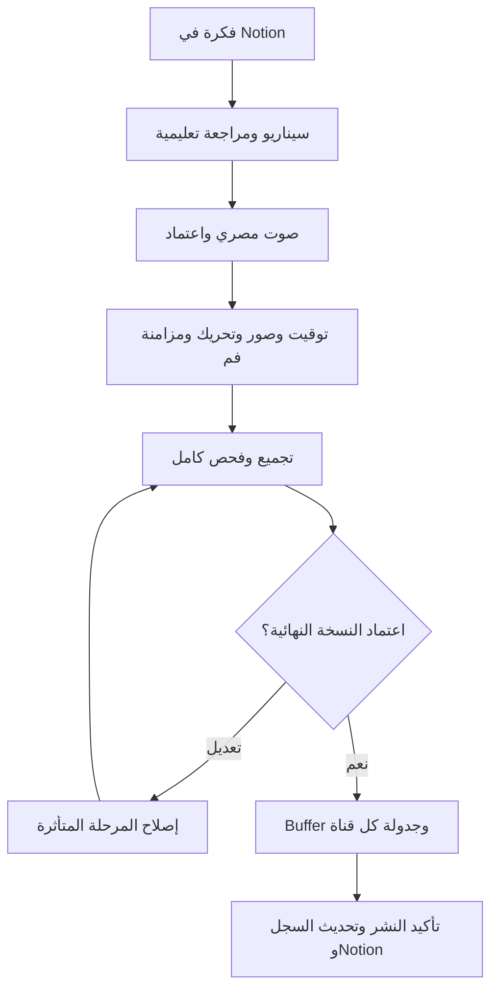

# خطة أتمتة مرح — مرجع التوسع المستقبلي

الحالة: خط أساس موثق بناءً على طلب المستخدم؛ Buffer اختيار المستخدم للنشر على TikTok وYouTube وFacebook فقط في الإصدار الأول؛ Facebook عبر صفحة، وYouTube Shorts للفيديو الرأسي الأول. لم تُهيأ الخدمات ولم يُشغّل إنتاج أو نشر. طلب المستخدم توثيق هذا المسار ورفعه إلى GitHub. لا تعني هذه الوثيقة شراء الخدمات أو نجاح التكامل أو الإذن بالنشر دون اعتماد النسخة النهائية.

> تحديث قرار المستخدم: التنفيذ الحالي مانوال وفق [دليل التشغيل](manual-production.md) و[جدول الشهر الأول](month-01-calendar.md). الأدوات والـAPI والبنية أدناه تصميم مستقبلي، وليست اشتراكات مطلوبة الآن.

## خطة الإنتاج الشهرية المعتمدة

| النوع | العدد | مدة العمل الواحد | الغرض |
| --- | --- | --- | --- |
| قصة تعليمية كاملة | 4 | 30–60 ثانية | بداية ومشكلة وحل وهدف تعليمي واحد |
| ريلز قصيرة مستقلة | 4 | 10–30 ثانية | معلومة أو سلوك أو تفاعل سريع |
| الإجمالي | 8 أعمال أصلية | 160–360 ثانية إجمالًا | نحو 2:40–6 دقائق محتوى نهائي شهريًا |

الجدول المستهدف: قصة وريلز كل أسبوع ضمن دورة إنتاج من أربعة أسابيع؛ لا زيادة تلقائية للشهور التي تضم خمسة أسابيع. قد يرتبط الريلز بموضوع القصة مع بقاء فكرته مستقلة. هذه أسماء تحريرية؛ تصنيف المنشور الفعلي تحدده المنصة والصيغة.

عند توزيع الأعمال الثمانية على TikTok وYouTube وFacebook عبر Buffer يصبح الإجمالي المستهدف 24 منشورًا شهريًا، بشرط اعتماد النسخ ودعم حسابات القنوات. لا يعني ذلك 24 فيديو أصليًا، ولا جدولة نشطة حاليًا.

افتراض الميزانية التخطيطي: 45 ثانية للقصة و20 ثانية للريلز = 260 ثانية (4:20 دقائق) محتوى نهائي شهريًا. هذا متوسط للحساب، وليس مدة إلزامية. تُحسب محاولات توليد الصور والتحريك والصوت ومزامنة الفم والتخزين منفصلة؛ لا توجد تكلفة شهرية إجمالية مؤكدة قبل قياس الاستهلاك. أول قصة يمكن أن تكون 30 ثانية ضمن النطاق المعتمد.

الخطة الشهرية تبدأ مانوال بقرار المستخدم؛ يبقى تصميم الأتمتة للتوسع بعد قياس إنتاج الشهر الأول.

## الأدوات المستهدفة

| المسؤولية | الاختيار | حدود القرار |
| --- | --- | --- |
| الأفكار والنصوص والمراجعة | Notion | المصدر التحريري؛ أي كتابة آلية تحتاج تكاملًا منفصلًا عن سر المرآة للقراءة فقط |
| التوثيق والكود ومرآة المحتوى | GitHub | لا ملفات فيديو كبيرة أو أسرار؛ مزامنة المحتوى الحالية غير مفعلة |
| التنسيق | n8n ذاتي الاستضافة داخل Docker | إصدار أول بوظيفة إنتاج واحدة متزامنة؛ انتظار الوظائف الخارجية دون إعادة إرسال |
| سجل الإنتاج | PostgreSQL | جداول التطبيق منفصلة عن جداول n8n، وحجز ذري للوظائف وقيد فريد لمنع التكرار |
| السيناريو والمخطط والوصف | OpenAI API | نموذج نصي يدعم مخرجات منظمة؛ يثبت معرف النموذج بعد تحقق الوصول والسعر والجودة، لا اشتراك ChatGPT |
| صور المشاهد | Nano Banana Pro عبر Gemini API | تحقق معرف النموذج وتوفره وحقوق الاستخدام؛ مراجع الشخصيات المعتمدة مدخل ثابت |
| الصوت | ElevenLabs API | صوت مصري ثابت لكل شخصية، مراجعة مسموعة؛ بوبو بلا صوت بشري |
| التحريك | Kling 3.0 عبر API رسمي | تحقق توفر النموذج والصور المرجعية والدقة؛ مزامنة الفم مرحلة مستقلة عند الحاجة، مزودها غير محسوم حتى إثبات توافقه |
| التجميع والفحص | عامل Python مع FFmpeg وffprobe | خدمة منفصلة عن خطوات n8n، تحويلات وإخراج قابل لإعادة التنفيذ |
| الأصول | Cloudflare R2 | أصول خاصة؛ نسخة توزيع نهائية معتمدة فقط في مساحة عامة منفصلة برابط HTTPS ثابت |
| الجدولة والنشر | Buffer API | فحص كل حساب ونوع محتوى وحقول المنصة، متابعة حتى النشر الفعلي |

Higgsfield واجهة اختيارية للإنتاج اليدوي، ولا تدخل في المسار الآلي الأساسي. اشتراكات المواقع لا تُفترض بديلًا لفوترة API. الخطة هدفها حركة طبيعية لشخصيات كرتونية ثابتة، وليست تحويلها تلقائيًا إلى بشر حقيقيين.

## المسار

المسار المرسوم مختصر؛ أي تعديل يعيد المراحل التابعة فقط، وتغيير الأصل يلغي موافقته. GitHub يستقبل نسخة المحتوى التحريري عبر المزامنة المحددة، لا تنتظر مزامنة GitHub لبدء كل خطوة إنتاج.

## بيانات وسلامة التنفيذ

- سجل محتوى ثابت: content_id وnotion_page_id وrevision والهدف والعمر والمدة والمنصات.
- حالات المراحل المقترحة: draft، script_review، audio_review، generating، rendering، final_review، approved، scheduled، published؛ مع failed وneeds_attention على مستوى المرحلة والقناة.
- سجل أصول: URI خاص، بصمة SHA-256، نوع الأصل، مدخلاته، provider_job_id، إصدار النموذج، التكلفة المقدرة والفعلية.
- الموافقة: معرف المراجع ووقت الموافقة وبصمة النسخة النهائية ومعلومات كل منصة؛ لا تكفي موافقة السيناريو للنشر.
- نشر منفصل لكل channel_id، بقيد فريد على content_id + revision + channel_id، وتخزين buffer_post_id والرابط الخارجي والوقت والنتيجة.
- ميزانية للحلقة ولكل مرحلة وسقف محاولات يحددان قبل التوليد المدفوع. عند نتيجة مبهمة افحص الوظيفة القائمة قبل طلب جديد.
- لا تنشر نسخة توزيع عامة قبل الموافقة. رابط Buffer يجب أن يظل مباشرًا ومتاحًا حتى النشر وإعادة المطابقة؛ لا تستخدم رابطًا موقعًا قصير العمر.
- إعدادات الأطفال والإفصاح عن المحتوى الاصطناعي والعناوين والأوصاف والحقوق تُراجع لكل منصة. إذا غاب حقل مطلوب من Buffer تتوقف القناة للتدخل، ولا يُتجاوز الشرط.
- جدولة المستخدم بتوقيت Africa/Cairo، والتحويل إلى UTC عند الإرسال؛ لا فرق توقيت ثابت يدويًا.
- فصل المتغيرات: NOTION_TOKEN للمرآة قراءة فقط، NOTION_EDITOR_TOKEN لتحديث حالات التحرير، ثم مفاتيح المزودين وBUFFER_API_KEY واعتماد R2 وDATABASE_URL داخل مخزن أسرار، لا Git.

## Notion وGitHub

المصدر التحريري Notion؛ التقنية والخطط GitHub. المزامنة الحالية تحفظ نطاق API الموثق، ولا تشمل تلقائيًا تعليقات Notion أو سجل الإصدارات أو بيانات لا يصل إليها التكامل. تعديل المحتوى في Git لا يكتب فوق Notion آليًا؛ تُرسل التعديلات التحريرية إلى المصدر أولًا. الأصول الكبيرة تحفظ في R2 مع بياناتها المرجعية، لا مستودع Git. نتائج الإنتاج والتكاليف ومعرفات النشر تحفظ في PostgreSQL وتنعكس خلاصتها في Notion؛ لا تضف أسرارًا أو روابط خاصة إلى المرآة العامة.

## Buffer وحدود الدعم

التحقق المرجعي بتاريخ 2026-10-15: API متاح في الخطط الحالية بما فيها Free بحدود مختلفة. الإرسال لكل قناة، وليس عملية ذرية لكل المنصات. مثال إنشاء فيديو موجود رسميًا. وثائق الجدولة وقائمة قنواتها لا تذكر TikTok، بينما وثائق استضافة الوسائط وMCP تذكره؛ هذا اختلاف يجب حسمه بفحص قدرات القناة الفعلية قبل تفعيلها. لا نعد بنشر جميع المنصات تلقائيًا قبل التحقق من الحسابات والحقول المطلوبة. لا يُعد scheduled دليل published.

المصادر:
- https://buffer.com/api
- https://developers.buffer.com/guides/posts-and-scheduling.html
- https://developers.buffer.com/guides/hosting-media.html
- https://developers.buffer.com/examples/create-video-post.html
- https://developers.buffer.com/guides/integrations/mcp.html/

## تسلسل التنفيذ

1. اعتماد هذا المخطط وتحديد الميزانية وربط الحسابات والخدمات دون نشر.
2. بناء مسار إنتاج واحد يحفظ الحالات والمدخلات والمخرجات ويستأنف بأمان.
3. إنتاج أول قصة تعليمية كاملة 30 ثانية ومراجعتها كاملة، مع السؤال والانتظار والنشاط وفق قواعد المشروع.
4. اعتماد النسخة المحددة، ثم اختبار مسار Buffer على القنوات المصرح بها ومتابعة النتيجة لكل قناة.
5. بعد نجاح الرحلة الأولى، تفعيل الجدولة المنتظمة والتوسع تدريجيًا.

الأولوية إكمال قصة واحدة بجودة مقبولة واستكمال آمن؛ لا تشغيل إنتاج جماعي قبل إثباتها. مزامنة الفم وتوفر واجهات المزودين وحقول الأطفال للقنوات تبقى شروط تحقق تنفيذية مفتوحة، لا تكاملات مكتملة.
