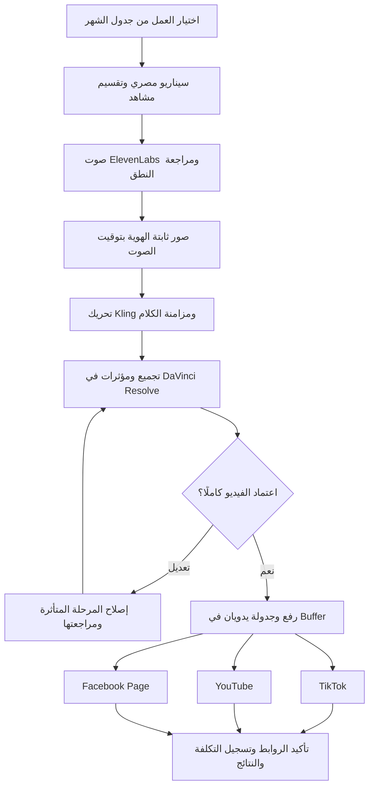

# التشغيل الحالي: إنتاج مانوال — الشهر الأول

قرار المستخدم في 15 أكتوبر 2026: البداية مانوال لتقليل الالتزامات، مع بقاء تصميم الأتمتة للتوسع. هذا القرار يحل محل افتراض البدء بتوصيل APIs أو تشغيل سيرفر إنتاج. لا توجد اشتراكات جديدة أو نشر أو ربط حسابات مؤكدة.

## النطاق

8 أعمال أصلية شهريًا: 4 قصص تعليمية مدة الواحدة 30–60 ثانية، و4 ريلز مدة الواحد 10–30 ثانية. مستهدف التوزيع: 24 منشورًا عبر Buffer إلى TikTok وYouTube وFacebook Page بعد موافقة المستخدم والتحقق من الحسابات. خطة الشهر في [الجدول](month-01-calendar.md).

## الرسم التنفيذي الحالي

هذا هو مسار التشغيل الحالي، وتنتقل الملفات بين الأدوات يدويًا. ChatGPT يساعد في السيناريو والصور ضمن المتاح؛ Notion يحفظ الأصل التحريري وGitHub يوثق القرارات والنسخ. واجهة التحريك وباقتها ومزود مزامنة الفم تحتاج حسمًا قبل التنفيذ المدفوع، ولا توجد خدمات مربوطة بالفعل. سهم الإصلاح مختصر: يرجع العمل للمرحلة المسؤولة وتُعاد مراحلها التابعة فقط، وأي تغيير للنسخة النهائية يلغي اعتمادها.

بعد الموافقة نرفع الملف مباشرة من الجهاز إلى واجهة Buffer؛ لا نحتاج رابط R2 عامًا أو API في هذا المسار. نراجع حقول الجمهور والأطفال والإفصاح والحقوق لكل منصة؛ إذا غاب حقل مطلوب نستكمله من المنصة قبل النشر. تأكيد الجدولة لا يعني النشر؛ نسجل رابط النتيجة لكل قناة يدويًا في Notion. تحديث GitHub يتم صراحة، وليس بمزامنة حية مفترضة.

## الأدوات وطريقة العمل

| المرحلة | التشغيل المانوال | شرط الإكمال |
| --- | --- | --- |
| التخطيط | ChatGPT للمساعدة، وNotion للمصدر التحريري | هدف واحد وقصة قابلة للتنفيذ في المدة |
| الصور | توليد هنا ضمن المتاح أو واجهة صور مناسبة، بمراجع الشخصيات | صور لكل مشهد بثبات الهوية؛ لا يفترض أن الاشتراك يغطي API |
| الصوت | ElevenLabs من واجهة الموقع، بصوت مصري ثابت لكل شخصية | الاستماع للحوار كاملًا وتصحيح النطق قبل التحريك |
| التحريك | واجهة Kling أو منصة تتيح النموذج | اختيار باقة بعد التحقق من رصيدها وحقوقها وميزانية الشهر؛ مزود واجهة التحريك لم يُشتر أو يُحسم |
| مزامنة الكلام | أداة مزامنة مناسبة عند الحاجة | تجربة توافق مع الشخصيات والصوت؛ المزود غير محسوم ولا وعد بأنها مشمولة |
| التجميع | DaVinci Resolve المجاني على الجهاز، وFFmpeg اختياري | حركة فعلية وصوت متزامن ونسخة نظيفة مناسبة للنشر |
| المراجعة | مشاهدة وسماع الفيديو كاملًا ثم موافقة المستخدم | اعتماد النسخة المحددة؛ أي تعديل يلغي الاعتماد السابق |
| التوزيع | رفع وجدولة يدويان من واجهة Buffer | مراجعة إعدادات كل منصة، ثم تأكيد النشر وتسجيل الروابط |
| السجل | Notion يدويًا، وتوثيق GitHub بتحديثات صريحة | لا ادعاء بوجود مزامنة حية؛ لا تعدل أرشيف Notion الخام |

## سير كل عمل

1. اعتماد الفكرة والهدف والنص المصري وقائمة المشاهد.
2. إنتاج الحوار لكل شخصية، ثم مراجعة النطق والوقفات والمدة.
3. إنتاج صور المشاهد، ثم التحريك حسب توقيت الصوت والفعل التعليمي.
4. مزامنة الكلام عند الحاجة، ثم إضافة المؤثرات والتجميع.
5. مراجعة الوجه والملابس والأطراف والاستمرارية والنطق ومستوى الصوت وحقوق الموسيقى.
6. عرض الفيديو كاملًا للمستخدم، وتسجيل موافقة مرتبطة بالإصدار وبصمة الملف.
7. رفع النسخة المعتمدة إلى Buffer لكل قناة، ومراجعة العنوان والوصف والجمهور وموعد النشر.
8. تأكيد النشر على كل قناة وتسجيل الرابط؛ عند نتيجة مبهمة افحص قبل إعادة الرفع.

لا تستخدم صورة ثابتة مع تحريك كاميرا بدل حركة الشخصيات. بوبو بلا كلام بشري. لا تمدد الصوت ولا تكرر اللقطات للحشو. يبقى سؤال الطفل وانتظار 2–3 ثوانٍ ونشاط ولي الأمر؛ يمكن وضع النشاط في وصف المنشور إذا ضاقت مدة الريلز.

## المصاريف

لا نحتاج شراء سيرفر أو n8n Cloud أو خطط PostgreSQL أو رصيد OpenAI/Gemini/Kling API لتنفيذ المسار المانوال. لا يعني ذلك أن توليد الصور والصوت والتحريك مجاني أو غير محدود. نختار اشتراك التحريك والصوت حسب احتياج حقيقي بعد التحقق من السعر والرصيد والتجديد والحقوق؛ لا نعتمد سنويًا من البداية.

التقدير السابق 60–80 دولارًا لمسار API مع مدد قصيرة لا يمثل سعر باقة مانوال ولا ضمان تكلفة الشهر. لم يعتمد المستخدم سقف إنفاق رقمي؛ يلزم تحديده قبل أي شراء أو توليد مدفوع. سجّل رصيد البداية والنهاية، تكلفة كل محاولة، المقبول والمرفوض، والوقت الفعلي لكل عمل.

يمكن البدء بـBuffer المجاني ما دامت القنوات الثلاث وإجمالي طابور كل قناة داخل حدوده الحالية؛ الخطة 8 منشورات لكل قناة، لكن افحص المنشورات الأخرى المحجوزة. يحتاج حساب Facebook صفحة، ويُتحقق نوع فيديو YouTube المدعوم. مسار الموقع اليدوي لا يعتمد على اكتمال API؛ إعدادات الأطفال والإفصاح أو أي حقول غير متاحة تُستكمل من المنصة قبل النشر.

## الحفظ والتتبع

لكل عمل معرف M01-01 إلى M01-08، ونسخ نص وصوت وصور ومشاهد وملف نهائي. مثال تسمية: M01-01_SC01_v001.mp4. سجل اسم الأداة والنموذج وإعداداته ومدة اللقطة وحالة الاعتماد وروابط النشر في Notion. ملفات الوسائط محليًا مع نسخة احتياطية مناسبة؛ Git للتوثيق ومعلومات النسخ، وليس لحفظ الفيديوهات الكبيرة أو الأسرار.

الجدول في GitHub خطة تحريرية جديدة، ولم يُكتب بعد إلى Notion. يجب نقلها إلى المصدر التحريري عند توفر الوصول؛ لا تعتبر مرآة التصدير محدثة تلقائيًا.

## الانتقال للأتمتة

بعد إنتاج الشهر، نقيس تكلفة الثانية المقبولة، وقت كل مرحلة، نسبة إعادة المشاهد وثبات الصوت والشخصيات. نؤتمت المراحل المتكررة تدريجيًا وفق [الخطة المستقبلية](automation-plan.md)، مع الحفاظ على موافقة النسخة النهائية. التشغيل المانوال الحالي لا يلغي عدد الأعمال أو الهوية التعليمية.
