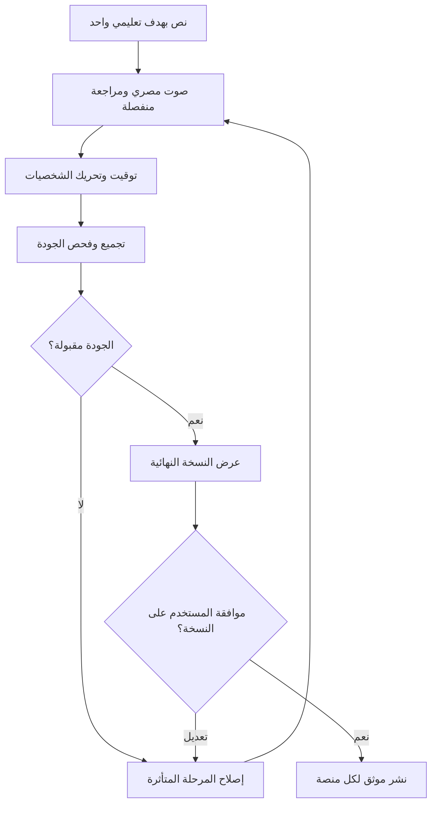

# مسار الإنتاج والمراجعة

مسار إنتاج الفيديو التالي هو التصميم المستهدف؛ لم يُشغّل آليًا بعد. وجود أداة مزامنة Notion واختباراتها لا يعني وجود أتمتة إنتاج أو نشر. البداية بسجل معتمد من Notion، والنهاية موافقة المستخدم على نسخة محددة قبل نشرها للعامة.

سهم الإصلاح يوضح إعادة المراجعة؛ التنفيذ يستأنف المرحلة المتأثرة فقط. تغيير الصوت يستلزم إعادة توقيت التحريك، وتغيير الملف النهائي يلغي موافقته السابقة.

## ١. النص والتعلم

حدد هدفًا واحدًا مناسبًا لعمر ٢–٦ سنوات. اعرض نموذجًا واضحًا، وفر فرصة ممارسة، ثم سؤالًا وانتظارًا حقيقيًا ٢–٣ ثوانٍ قبل الإجابة. اختم بنشاط بسيط مع ولي الأمر. راجع اللهجة المصرية والوضوح والحقائق والملاءمة العمرية قبل إنتاج الصوت.

## ٢. الصوت أولًا

أنشئ الصوت ثم راجعه منفصلًا: النطق المصري، الأداء، الوقفات، مستوى الصوت، وصحة النص. بوبو لا يتحدث بصوت بشري. بعد اعتماد الصوت، استخرج المدد والتوقيتات لبناء اللقطات. لا تمدد الصوت لتلبية مدة فيديو مسبقة ولا تحذف انتظار السؤال.

## ٣. الصور والتحريك

ثبت مراجع الشخصيات: لوما ببلوزة وردية طويلة الأكمام وسالوبيت جينز وفيونكة وردية؛ دودو بهودي أزرق مفتوح وتيشيرت أبيض وبنطلون أزرق؛ بوبو بيغل بطوق أحمر.

خطط لقطات عادةً من ٥–١٠ ثوانٍ، وفق مدة الصوت والفعل التعليمي وحدود المزود. الحدود تختلف حسب الخدمة والطراز؛ تُتحقق قبل الطلب. قسّم اللقطات الطويلة إلى أفعال مترابطة، واجعل الانتقالات طبيعية. يجب ظهور حركة فعلية للشخصية وتنفيذ الفعل المقصود؛ pan/zoom وحده غير كافٍ، وتكرار اللقطات للحشو غير مقبول.

## ٤. التجميع وفحص الجودة

يمكن استخدام FFmpeg للتجميع وضبط الصوت وإخراج نسخ المنصات بعد التقييم. راجع تزامن الصوت والفعل، ثبات الوجه والملابس والأطراف، الاستمرارية، الوضوح، الانتظار التعليمي، والنشاط الختامي. افحص الفيديو كاملًا، لا عينات متفرقة فقط. أي فشل يعود للمرحلة المسؤولة ضمن سقف التكلفة وإعادة المحاولة.

## ٥. الموافقة والنشر

اعرض النسخة النهائية ونسخ المنصات اللازمة للمراجعة. سجّل موافقة المستخدم مع إصدار الملف وبصمته. لا تعني الموافقة على النص أو الصوت موافقة على النشر. لا يُنشر على YouTube أو Facebook أو Instagram أو TikTok إلا بعد الموافقة الصريحة على الأصل النهائي، وبعد تهيئة حسابات المنصات وصلاحياتها.

لكل منصة مفتاح منع تكرار وسجل نتيجة ومعرّف منشور مستقل. عند فشل أو انقطاع استجابة، طابق حالة المنصة قبل إعادة الإرسال. التعديلات بعد الموافقة تتطلب موافقة جديدة على النسخة المعدلة.

## تنفيذ المسار عبر Buffer

وفق [خط أساس الأتمتة](automation-plan.md)، يبدأ الإصدار الأول بقصة تعليمية كاملة 30 ثانية، ثم مراجعة وموافقة على بصمة النسخة، ثم جدولة مستقلة لكل قناة عبر Buffer. يسجل النظام scheduled عند قبول الجدولة، ولا يسجل published إلا بعد تأكيد النشر. لا تفرض المدة ضغط الكلام أو حذف انتظار الطفل؛ تُراجع القصة وتوقيتها قبل التوليد المدفوع. أي قناة لا تدعم الحقول المطلوبة تتوقف للتدخل.
